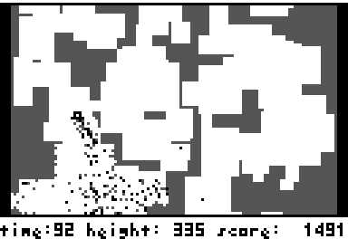
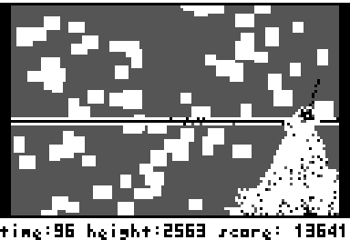
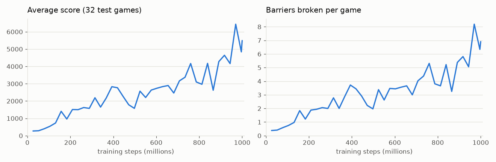

# spout_pro

A reinforcement-learning agent for **Spout**, a tiny cave-flying game. It learns
from the same screen a human sees, and after about a billion steps of practice it
blasts through barrier after barrier.

<p align="center"></p>

## The game

You fly a little ship up an endless cave. Left and right rotate it; thrust pushes
it and sprays exhaust grains out the back. The grains bounce around and chip away
at the rock, so the exhaust doubles as a weapon. Every 128 pixels of height a solid
barrier spans the whole cave, and the only way through is to blast a hole in it.
Since the exhaust goes out the back, that means turning the nozzle *up*, which
pushes you *down*: flip, spray while falling, flip back, and fly through before
gravity wins.

You start with 60 seconds. Each barrier adds 60 more (up to 99) and a bonus of 10
points per second left. Higher up, the open pockets shrink and the cave turns into
near-solid rock you have to dig through.

## Results

One run of about 1 billion steps (roughly 3 GPU-hours on an A100 and an H100).
Scores are from games with fresh random caves the agent never trained on:

| | |
|---|---|
| Average score, 64 games (10-minute cap) | **4,900** (median 4,332) |
| Barriers broken per game | **6.2** on average, up to 15 |
| Best game with no time cap | **14,451 points, 21 barriers, height 2,751, 15 minutes** |

The time limit is no longer what ends its games: every one of the uncapped games
ended in a crash, never with the clock running out.

<p align="center"></p>
<p align="center"><sub>Height 2,570, score 13,851: tunneling through the dense upper cave</sub></p>

<picture>
  <source media="(prefers-color-scheme: dark)" srcset="assets/learning_curve_dark.png">
  
</picture>

## Quick start

Needs Linux, a C compiler with OpenMP (gcc), and [uv](https://docs.astral.sh/uv/).
An NVIDIA GPU is strongly recommended for training; watching the trained agent
works on any machine.

```bash
git clone --recurse-submodules https://github.com/Magnetesim/spout_pro.git
cd spout_pro
uv sync

# Play it yourself (arrows rotate, space thrusts, q quits)
uv run python -m spout_rl.play human

# Download the trained agent and watch it play
mkdir -p models
curl -L -o models/spout-agent.pt \
  https://github.com/Magnetesim/spout_pro/releases/download/v0.1.0/spout-agent.pt
uv run python -m spout_rl.play watch models/spout-agent.pt

# Score it on 64 fresh games, save the best one, and turn it into a video
uv run python -m spout_rl.evaluate models/spout-agent.pt --episodes 64 --save-best best.json
uv run python -m spout_rl.play replay best.json --video best.mp4
```

The C engine builds itself the first time it's imported.

## Training

```bash
# Laptop-sized defaults: 256 games in parallel
uv run python -m spout_rl.train --run-name mine

# Big GPU (A100/H100): 1024 games, as used for the results above
uv run python -m spout_rl.train --run-name big --num-envs 1024 --minibatches 32 \
  --env-threads 16 --total-steps 1000000000

uv run tensorboard --logdir runs
```

Each run writes to `runs/<name>/`: `latest.pt` (every few minutes), `best.pt`
(best average test score), TensorBoard logs, and a replay of the best game from
each round of test games, which `play replay` can show or turn into a video.

- **Resume** an interrupted run with `--resume runs/<name>/latest.pt`. A
  SIGTERM (Ctrl-C, or a cluster time limit) finishes the current update, saves
  and exits cleanly. Checkpoints are written atomically.
- **Fine-tune** with different settings using `--init-from <checkpoint>`, which
  loads only the network weights and starts a fresh learning-rate schedule.
- **Every reward and practice setting is a flag** (`--env-r-death`,
  `--env-p-drill`, ...). See `--help`.

Rough training speed (agent steps per second):

| GPU | Games | Steps/s |
|---|---|---|
| RTX 4060 laptop | 256 | ~12,500 |
| A100 | 1024 | ~84,000 |
| H100 | 1024 | ~130,000 |

## How it works

**A faithful, fast copy of the game.** `csrc/` is a line-by-line port of the
original `spout.c` game loop with no graphics: all game state lives in a struct,
each game has its own seeded random-number generator, and many games step in
parallel with OpenMP. `tests/fidelity/` compiles the *original* `spout.c` against a
fake SDL, feeds both versions the same random numbers and button presses, and
checks that the screen, the world buffer and the ship state are identical on every
frame. They are, across hundreds of games and every height. So the agent is
playing the real game, and every replay is exactly reproducible from a seed and a
list of moves.

```bash
make -C tests/fidelity          # no SDL needed
```

**What the agent sees.** Only what a player sees: the last four screens of the
128×78 play area exactly as the game draws them (white, gray and black; rock looks
the same whether it's fresh or one hit from breaking), plus the numbers a player
can read off the screen:
time left, height, and the ship's position, heading and speed. It gets no
peeking at cave above the screen and no access to the game's internals.

**What it can do.** Six actions: {no turn, left, right} × {coast, thrust}, each
held for 4 frames (12.5 decisions per second).

**Rewards.**

| Event | Reward |
|---|---|
| Each pixel climbed | +0.1 |
| Breaking through a barrier | +5 |
| The game's time bonus | +0.01 per point |
| Crashing or running out of time | −5 |
| Chipping rock just above the ship | small, fades to zero over the first half of training |

**Practice runs.** Breaking barriers is the hard skill, so not every game starts
at the bottom: 30% start with a barrier already on screen, and 20% start at a
random height anywhere up to 1,500, which includes the dense upper cave. The
cave in those starts is generated by the game's own code, so it looks exactly
like the real thing.

**Learning.** PPO with an Atari-style CNN. 1024 games × 128 steps per update,
minibatches of 4096, 3 epochs, discount 0.995. The games are split into two
halves so the CPU steps one half while the GPU picks moves for the other, and the
update runs in bfloat16 with `torch.compile`.

## Things to try

- **Reward speed:** weight the time bonus more, so the agent prefers open paths
  over digging.
- **Look further ahead:** a discount of 0.998 instead of 0.995 lets the agent see
  a crash's real cost (every future barrier, not just the next one), which should
  make it more careful.
- **Just train longer:** the curve above was still climbing.

## Layout

```
csrc/            headless C engine + batched environment (builds libspout.so)
spout_rl/        Python: env wrapper, model, PPO trainer, evaluation, viewer
tests/fidelity/  original-vs-port frame comparison
spout/           the original game (git submodule)
```

## Credits

Spout was written by **Kuni** for the P/ECE handheld, ported to Windows/SDL, and
later cleaned up for Unix by **Nick White**. The `spout/` submodule is
[my fork](https://github.com/Magnetesim/spout) of Nick White's version, with 64-bit
fixes and tunable constants.

## License

MIT, see [LICENSE](LICENSE). The game engine in `csrc/` is a port of the original
MIT-licensed Spout code, and keeps its copyright lines.
